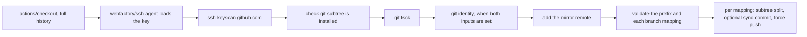

# Architecture

The action is one composite [`action.yaml`](../../action.yaml) whose steps run in the caller's job.

Inputs reach shell steps through `env`, never through `${{ }}` inside `run`, so an input cannot inject shell code.
`git subtree split` walks the whole history on each run, so its time grows with the repository.
